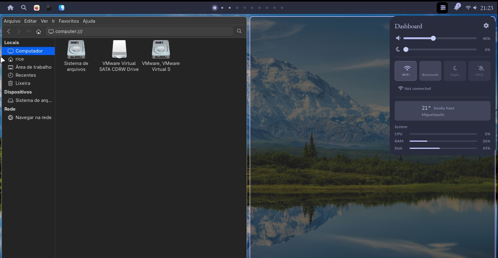

# hypr_karol

Rice Hyprland e QuickShell Karol.

Baseado nas configurações de [karol-broda/nixos-config](https://github.com/karol-broda/nixos-config).



## Conteúdo

O archive `Assets/rice-configs.tar.gz` preserva a estrutura Linux, links simbólicos e permissões. Inclui:

- Hyprland e scripts, incluindo Rofi em `~/.config/hypr/rofi`
- QuickShell Karol e Elephant
- GTK 3/4, Qt 5/6, Foot e nwg-look
- Units de usuário do Elephant e do sincronizador de ícones do QuickShell
- Fontes locais e temas WhiteSur-Dark-solid (GTK), MacTahoe-dark (ícones) e Bibata-Modern-Ice (cursor)

- O botão Night controla o filtro de luz azul do `hyprsunset`; o DND silencia os pop-ups e mantém as notificações no histórico.
- A visibilidade de cada botão pode ser configurada em `~/.config/quickshell/karol/config/Config.qml` (`showNightToggle` e `showDndToggle`).

## Instalação

Scripts destinados ao Arch Linux e derivados. Instale os pacotes antes de aplicar as configurações:

```bash
bash install-pkg.sh
bash install-rice_config.sh
```

`install-pkg.sh` verifica se `yay` está disponível. Se não estiver, instala os pré-requisitos, compila e instala `yay-bin`; em seguida instala os pacotes do rice com `--needed`, incluindo dependências do Hyprland, QuickShell, Elephant, Rofi, hyprsunset, temas, fontes, terminal e ferramentas usadas pelos scripts.

`install-rice_config.sh` instala os caminhos do archive sob `$HOME`. Antes de substituir destinos existentes, move-os para um backup com data em `~/.local/state/hypr_karol/backups/`. Também adapta à home atual os links GTK que apontavam para `/home/rice`, atualiza o cache de fontes e ativa as units do Elephant, do sincronizador de ícones do QuickShell e do PipeWire, além dos serviços de sistema NetworkManager e Bluetooth.

O Quickshell é iniciado pelo script da sessão do Hyprland. Entre novamente na sessão após a instalação.
